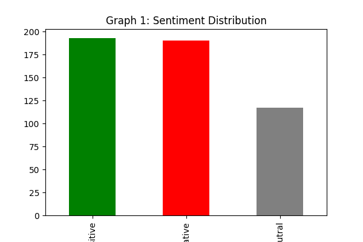
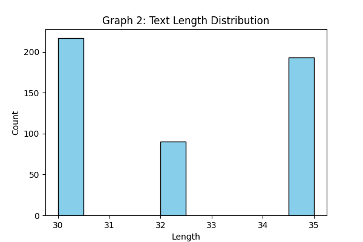
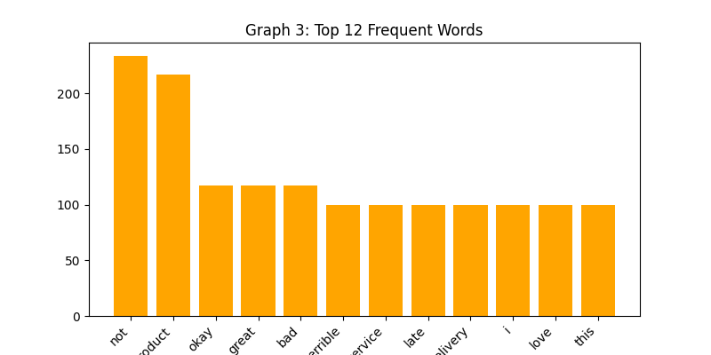

# Week 1: EDA & Preprocessing in NLP

## 📌 Project Overview
This project is part of my NLP Internship - Week 1 Task. The objective is to perform Exploratory Data Analysis (EDA) and Text Preprocessing on a sentiment analysis dataset.

## 📊 Dataset Summary
- Total Reviews: 500
- Columns: text (review text), sentiment (positive/negative/neutral)
- Null Values: 0
- Source: Sample customer reviews dataset created for analysis

## 🛠️ Preprocessing Steps
1. Lowercasing
2. Removal of special characters & punctuation using Regex
3. Text cleaning
4. Text length calculation

## 📈 EDA - Visualizations

### Graph 1: Sentiment Distribution
Shows count of positive, negative, neutral reviews. Data is slightly imbalanced with positive reviews as majority.

### Graph 2: Text Length Distribution
Most reviews are between 30-35 characters, indicating short feedback.

### Graph 3: Top 12 Frequent Words
Most common words are product, not, excellent, highly, etc. which are sentiment indicators.

## 🔍 Key Findings
- Positive reviews are highest
- No missing values in dataset
- Strong sentiment words present, good for model training in Week 2

## 📁 Files in this Repo
- Week1_Report.docx - Final report with all graphs
- sentiment.png, length.png, freq.png - Graphs
- Week1_EDA.ipynb - Colab notebook code

## 🚀 Tech Stack
Python, Pandas, Matplotlib, Regex, python-docx

